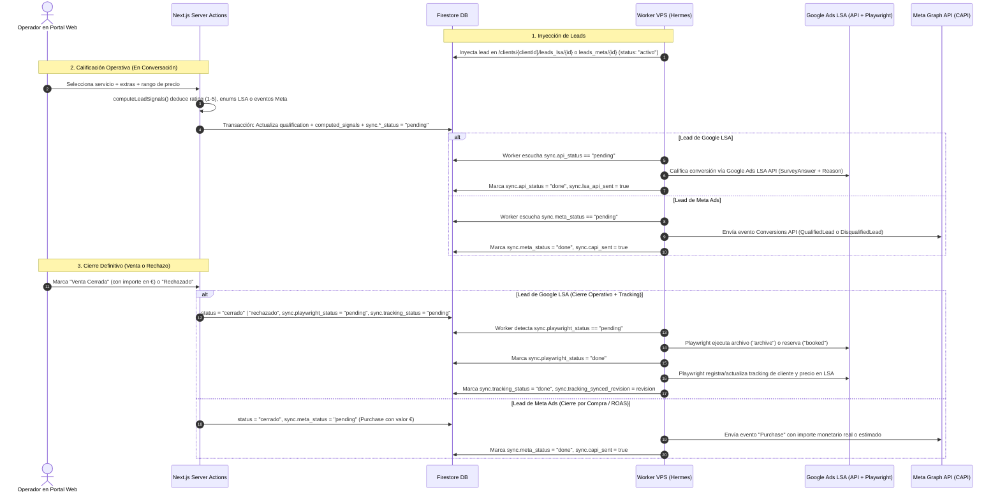

# Arquitectura y Pipeline: Calificación, Cierre y Sincronización (Web ↔ Firestore ↔ VPS Hermes)

Esta especificación técnica documenta el funcionamiento integral, actualizado y definitivo del sistema de calificación de leads en Estudio Digital Pro, detallando la interacción entre la plataforma web (Next.js), la base de datos (Google Cloud Firestore) y los workers automatizados en el VPS (`hermesbot`).

Este documento constituye el contrato de datos y de sincronización vigente entre el desarrollo frontend/backend y los procesos batch/workers desplegados en el servidor VPS.

---

## 1. Topología de Colecciones en Firestore

Cada empresa cliente registrada en el área privada (`palma`, `shalom`, `jg`, `laterra`, `duala`, `henry`, etc.) posee sub-colecciones segmentadas por canal publicitario:

```text
/clients/{clientId}/
    ├── leads_lsa/{leadId}             # Leads provenientes de Google Local Services Ads (LSA)
    ├── leads_meta/{leadId}            # Leads captados a través de Meta Ads (Facebook/Instagram)
    └── daily_metrics/{date}           # Métricas agregadas por día y canal (importadas por Hermes)
```

### Identificadores y Control Multi-Cliente
- **Clientes actuales:** `jg` (Mudanzas JG), `palma` (Mudanzas Palma), `shalom` (Mudanzas Shalom), `laterra` (Mudanzas La Terra), `duala` (Mudanzas Duala), `henry` (Mudanzas Henry).
- **Mapeo de Membresía:** Se gestiona en `/client_members/{userId}_{clientId}`.
- **Conmutación:** El usuario activo conmuta entre sus clientes mediante la cookie `portal_client_id`, cargando dinámicamente las sub-colecciones correspondientes.

---

## 2. Ciclo de Vida y Pipeline de Sincronización

El sistema separa completamente la operativa de **Google LSA** (que combina la Google Ads API con automatizaciones de Playwright en la consola web) y la de **Meta Ads** (que se comunica vía Meta Conversions API / CAPI):



---

## 3. Estructura Oficial del Documento Lead en Firestore

Cada lead almacenado en `/clients/{clientId}/leads_lsa/{leadId}` o `/clients/{clientId}/leads_meta/{leadId}` cumple estrictamente con el siguiente esquema JSON:

```typescript
{
  // ── 1. Metadatos del lead y contacto ──────────────────────
  "id": "lsa_335433531",
  "client_id": "jg",
  "channel": "google_lsa",               // "google_lsa" | "meta_ads"
  "lead_type": "message",                // "message" | "phone_call" | "booking"
  "status": "en_conversacion",            // "activo" | "en_conversacion" | "cerrado" | "rechazado"
  "contact_name": "Carlos Mendoza",
  "phone": "+34600000000",
  "email": "carlos@example.com",
  "message": "Hola, necesito presupuesto para mudar un piso de 3 habitaciones...",
  "service_type": "mudanza_mediana",
  "lead_created_at": "2026-10-10T09:15:00Z", // Timestamp real de generación del lead (prioritario)
  "created_at": "2026-10-10T09:15:00Z",      // Timestamp de inserción técnica en Firestore
  "updated_at": "2026-10-12T14:30:00Z",

  // ── 2. Origen publicitario exacto (Multi-Origen JG / Cuentas) ────────
  "advertising_source": {
    "channel": "google_lsa",
    "customer_id": "9060286511",          // Customer ID de cuenta publicitaria LSA
    "external_lead_id": "335433531"
  },
  // O en caso de Meta Ads:
  // "advertising_source": {
  //   "channel": "meta_ads",
  //   "ad_account_id": "act_1132664364628348",
  //   "campaign_id": "120256065951050002",
  //   "external_lead_id": "lead_meta_456",
  //   "external_id_kind": "ghl_contact",
  //   "adset_id": null,
  //   "ad_id": null,
  //   "form_id": null,
  //   "meta_lead_id": null
  // },

  // ── 3. Calificación operativa guardada por el usuario ─────
  "qualification": {
    "service": "mudanza_mediana",        // QualificationServiceKey
    "has_storage": true,                 // Modificador Guardamuebles
    "has_elevator": false,               // Modificador Elevador / Grúa
    "is_national": true,                 // Modificador Mudanza Nacional
    "price_range": "500_1000",           // "<250" | "250_500" | "500_1000" | "+1000" | null
    "status": "en_conversacion",         // "en_conversacion" | "venta" | "rechazado"
    "sale_amount": null,                 // Importe real en € (solo si status === "venta" y se aportó)
    "qualified_at": "2026-10-12T14:30:00Z"
  },

  // Facturación a nivel de raíz (null si se omitió el importe real para no distorsionar finanzas)
  "sale_amount": null,

  // ── 4. Señales automáticas deducidas por computeLeadSignals ─
  "score": 5,                            // Rating algorítmico interno (1 al 5)
  "computed_signals": {
    "internal_rating": 5,
    "lsa_sentiment": "VERY_SATISFIED",   // Enum oficial Google Ads RPC v23
    "lsa_reason": "HIGH_VALUE_SERVICE",  // Enum oficial Google Ads RPC v23
    "meta_event": "QualifiedLead",       // "QualifiedLead" | "DisqualifiedLead" | "Purchase" | null
    "meta_value": null,                  // Importe en € enviado a Meta
    "meta_currency": "EUR",
    "meta_value_source": null,           // "actual" | "range_estimate" | null
    "playwright_action": null            // "archive" | "booked" | null (solo al cerrar)
  },

  // ── 5. Tracking de Booked en Google LSA (Editable por revisiones) ──
  "tracking": {
    "customer_name": "Carlos Mendoza",
    "price_estimate": 750,
    "revision": 1                        // Entero incremental (1, 2, 3...)
  },

  // ── 6. Colas de sincronización para el worker Hermes (VPS) ─
  "sync": {
    // Cola A: Google Ads API Rating (Inmutable una vez "done")
    "api_status": "pending",             // "pending" | "done" | "error" | null
    "api_sent_at": null,                 // ISO Timestamp
    "api_error": null,
    "lsa_api_sent": false,

    // Cola B: Cierre Operativo Playwright (Inmutable una vez "done")
    "playwright_action": null,           // "archive" | "booked" | null
    "playwright_status": null,           // "pending" | "done" | "error" | null
    "playwright_error": null,

    // Cola C: Tracking de Reserva en LSA (Re-sincronizable)
    "tracking_status": null,             // "pending" | "done" | "error" | null
    "tracking_synced_revision": null,    // Última revisión confirmada por Hermes
    "tracking_sent_at": null,
    "tracking_error": null,

    // Cola D: Meta Conversions API (CAPI)
    "meta_status": null,                 // "pending" | "done" | "error" | null
    "meta_sent_at": null,
    "meta_error": null,
    "capi_sent": false,

    "last_sync_attempt": null
  }
}
```

---

## 4. El Modelo de Calificación en 4 Bloques (UI / Lógica Operativa)

La interfaz del portal de clientes estructura la calificación en cuatro bloques secuenciales rápidos:

### Bloque A: Tipo de Requerimiento (Servicio Base)
- **Descartes Claros (Incompatibilidad Directa):**
  - `spam_empleo`: Spam publicitario, ofertas de trabajo o números falsos.
  - `fuera_zona`: Solicitudes en ciudades o provincias fuera de cobertura operativa.
  - `porte_bulto`: Traslados menores de un solo mueble o electrodoméstico.
  - `furgoneta`: Solicitudes de portes rápidos o alquiler de vehículo sin cuadrilla.
- **Servicios de Mudanza:**
  - `mudanza_pequena` (o `mudanza_chica`): Estudios o pisos de 1 habitación.
  - `mudanza_mediana`: Pisos habituales de 2 a 3 habitaciones.
  - `mudanza_grande`: Chalets, pisos de 4+ habitaciones o traslados de oficinas/naves.

### Bloque B: Modificadores de Valor (Toggles On/Off)
- **Guardamuebles (`has_storage`):** Custodia y depósito temporal de mobiliario.
- **Elevador / Grúa por Fachada (`has_elevator`):** Necesidad de maquinaria para pisos altos.
- **Mudanza Nacional (`is_national`):** Mudanzas interprovinciales de larga distancia.

### Bloque C: Presupuesto Estimado (Rango de Selección)
- `< 250 €` (menor a 250 €)
- `250 - 500 €`
- `500 - 1.000 €`
- `+ 1.000 €` (más de 1.000 €)

### Bloque D: Estado Comercial (Acción Final)
- `en_conversacion`: Lead activo en negociación o esperando respuesta.
- `venta`: Servicio cerrado y contratado.
- `rechazado`: Lead descartado por incompatibilidad o descarte comercial.

> [!IMPORTANT]
> **Regla de Bloqueo Automático (`isClientDiscard`):**
> Si el usuario selecciona un servicio de descarte claro (`spam_empleo`, `fuera_zona`, `porte_bulto`, `furgoneta`), o si el lead exige una capacidad operativa que el cliente no posee (ver Sección 5), la interfaz **bloquea obligatoriamente el estado a "Rechazado"** e inhabilita las opciones "En Conversación" y "Venta Cerrada".

---

## 5. Capacidades Operativas Dinámicas del Cliente (`client_features`)

Para evitar depender de nombres de clientes codificados en el código fuente, la plataforma lee las capacidades operativas configuradas en Firestore en `/clients/{clientId}.features`:

```typescript
export type ClientFeatures = {
  has_elevator: boolean;      // ¿Dispone de grúa elevadora propia?
  accepts_national: boolean;  // ¿Acepta rutas de mudanza nacional?
};
```

### Reglas de Incompatibilidad Dinámica:
1. **Elevador / Grúa (`has_elevator`):**
   - Si el lead requiere elevador (`has_elevator: true`) pero el cliente **NO** dispone de maquinaria (`client_features.has_elevator === false`), el lead se invalida automáticamente:
     - LSA: `VERY_DISSATISFIED` + `JOB_TYPE_MISMATCH`.
     - Meta: `DisqualifiedLead`.
     - Rating interno: **1**.
     - Playwright: `archive` (si se rechaza).
2. **Mudanza Nacional (`is_national`):**
   - Si el lead es de ámbito nacional (`is_national: true`) pero el cliente opera **únicamente a nivel local** (ej. Shalom: `client_features.accepts_national === false`), el lead se invalida por tratarse de un servicio que no se ofrece:
     - LSA: `VERY_DISSATISFIED` + `JOB_TYPE_MISMATCH`.
     - Meta: `DisqualifiedLead`.
     - Rating interno: **1**.
     - Playwright: `archive` (si se rechaza).

---

## 6. Matriz Algorítmica de Calificación en Cascada (`computeLeadSignals`)

La función central `computeLeadSignals` en `lib/portal/qualification.ts` deduce todas las señales publicitarias oficiales ejecutando las siguientes comprobaciones en orden estricto de precedencia:

### Cascada de Evaluación:

1. **Descartes Claros y Spam Universal:**
   - `spam_empleo` ➔ LSA `VERY_DISSATISFIED` + `SOLICITATION` | Meta `DisqualifiedLead` | Rating **1** | PW `archive`.
   - `fuera_zona` ➔ LSA `VERY_DISSATISFIED` + `GEO_MISMATCH` | Meta `DisqualifiedLead` | Rating **1** | PW `archive`.
   - `porte_bulto` o `furgoneta` ➔ LSA `VERY_DISSATISFIED` + `JOB_TYPE_MISMATCH` | Meta `DisqualifiedLead` | Rating **1** | PW `archive`.

2. **Excepción de Mudanza Nacional Incompatible (Servicio no ofrecido):**
   - Si `is_national: true` y `!acceptsNationalCapability` ➔ LSA `VERY_DISSATISFIED` + `JOB_TYPE_MISMATCH` | Meta `DisqualifiedLead` | Rating **1** | PW `archive`.

3. **Excepción de Elevador Incompatible:**
   - Si `has_elevator: true` y `!hasElevatorCapability` ➔ LSA `VERY_DISSATISFIED` + `JOB_TYPE_MISMATCH` | Meta `DisqualifiedLead` | Rating **1** | PW `archive`.

4. **Mudanza Pequeña (`mudanza_pequena` sin guardamuebles, elevador ni nacional):**
   - Si `status === "rechazado"` ➔ LSA `DISSATISFIED` + `JOB_TYPE_MISMATCH` | Meta `DisqualifiedLead` | Rating **2** | PW `archive`.
   - Si `status === "venta"` ➔ LSA `NEUTRAL` (sin razón adjunta) | Meta `Purchase` | Rating **3** | PW `booked`.
   - Si `status === "en_conversacion"` ➔ Se mantiene en espera (`lsa_sentiment: null`, `meta: null`, Rating **3**). **No satura los algoritmos publicitarios con calificaciones tempranas.**

5. **Ventas Cerradas (`status === "venta"`):**
   - Si es **Alto Valor** (`price_range === "+1000"` O `has_storage` O `is_national` O `has_elevator` O `service === "mudanza_grande"`):
     ➔ LSA `VERY_SATISFIED` + `HIGH_VALUE_SERVICE` | Meta `Purchase` | Rating **5** | PW `booked`.
   - Si es venta estándar:
     ➔ LSA `SATISFIED` + `BOOKED_CUSTOMER` | Meta `Purchase` | Rating **4** | PW `booked`.

6. **Mudanzas Medianas / Grandes / Nacionales (En Conversación o Rechazo Comercial):**
   - Si es **Alto Valor** (`mudanza_grande`, `has_storage`, `is_national` o `has_elevator`):
     ➔ LSA `VERY_SATISFIED` + `HIGH_VALUE_SERVICE` | Meta `QualifiedLead` | Rating **5**.
   - Si es estándar:
     ➔ LSA `SATISFIED` + `SERVICE_RELATED` | Meta `QualifiedLead` | Rating **4**.
   - En caso de rechazo comercial posterior: PW `archive`.

### Mapeo de Estrellas (Rating Interno 1 a 5):
- **1 estrella:** `VERY_DISSATISFIED`
- **2 estrellas:** `DISSATISFIED`
- **3 estrellas:** `NEUTRAL`
- **4 estrellas:** `SATISFIED`
- **5 estrellas:** `VERY_SATISFIED`

---

## 7. Doble Capa Económica: Facturación Real vs Estimación de Respaldo CAPI

Para proteger las métricas contables del cliente y a la vez alimentar con exactitud los algoritmos de puja por valor (ROAS) de Meta Ads y Google LSA, el sistema implementa una **separación contable estricta**:

| Escenario de Registro | `qualification.sale_amount` | `lead.sale_amount` (raíz) | `computed_signals.meta_value` | `meta_value_source` |
|:---|:---:|:---:|:---:|:---:|
| **Importe Real Aportado** (ej. 1.350 €) | `1350` | `1350` | `1350` | `"actual"` |
| **Importe Omitido** (solo rango seleccionado) | `null` | `null` | Estimación numérica | `"range_estimate"` |

### Valores Conservadores por Rango:
- `< 250 €`: **200 €**
- `250 - 500 €`: **250 €**
- `500 - 1.000 €`: **500 €**
- `+ 1.000 €`: **1.000 €**

> [!NOTE]
> **Validación en Servidor y UI:** Si un operador cierra una venta sin introducir un importe numérico, el sistema le **exige obligatoriamente** seleccionar un rango de presupuesto. Antes de guardar, la interfaz muestra un modal de aviso confirmando que se empleará la estimación del rango para la optimización publicitaria sin alterar el balance de ingresos reales.

---

## 8. Pipeline de Google LSA: Tres Colas Asíncronas y Desacopladas

En `lib/portal/lsa-sync.ts`, la sincronización de leads de Google LSA se divide en tres acciones independientes:

### Cola 1: Rating Oficial vía Google Ads API (`sync.api_status`)
- Se encola (`pending`) únicamente cuando existe un sentimiento deducible (`VERY_DISSATISFIED` ... `VERY_SATISFIED`) y no ha sido enviado con anterioridad (`sync.lsa_api_sent === false`).
- **Inmutabilidad:** Una vez completada (`"done"`), jamás se recalcula ni se vuelve a enviar, evitando errores de duplicidad en la Google Ads API.

### Cola 2: Cierre Definitivo vía Playwright (`sync.playwright_status`)
- Se encola (`pending`) cuando el lead pasa a `venta` (`booked`) o `rechazado` (`archive`).
- **Bloqueo Transaccional:** Una vez solicitado el cierre, el sistema rechaza cualquier intento de alternar entre venta y rechazo.

### Cola 3: Tracking de Reserva Re-editable (`sync.tracking_status`)
- Aplica exclusivamente a leads cerrados como venta (`booked`).
- Permite actualizar el nombre del cliente (`tracking.customer_name`) o el importe final (`tracking.price_estimate`) a posteriori sin reiniciar el rating por API ni re-archivar en Playwright.
- Cada modificación incrementa atómicamente `tracking.revision` en `+1`.
- Si se omite el importe en una edición posterior, el sistema conserva el importe existente en Firestore, sin forzar `0` ni borrarlo.

---

## 9. Pipeline de Meta Ads: CAPI y Cierre Definitivo

En `lib/portal/meta-sync.ts`:
- **Inmutabilidad Absoluta de la Venta:** Si un lead de Meta Ads ya tiene una venta cerrada confirmada, el servidor bloquea cualquier edición posterior para proteger la integridad del Dataset / Píxel y los modelos de optimización de Meta.
- **Idempotencia de Eventos:** Si los datos del lead se editan pero el evento deducido (`meta_event`) no cambia y ya estaba en `"done"`, el estado de sincronización se preserva intacto sin generar eventos repetidos en la Graph API.
- **Aislamiento de Canales:** Los leads de Meta nunca activan `sync.playwright_status` ni `sync.api_status` (permanecen estrictamente en `null`).

---

## 10. Contrato Oficial Google Ads RPC v23 Enums

El worker Hermes en el VPS (`hermesbot`) utiliza estrictamente los enums oficiales del SDK de Google Ads RPC v23:

### A. Sentimientos de Encuesta (`LocalServicesLeadSurveyAnswerEnum.SurveyAnswer`)
- `VERY_DISSATISFIED` (Rating 1)
- `DISSATISFIED` (Rating 2)
- `NEUTRAL` (Rating 3)
- `SATISFIED` (Rating 4)
- `VERY_SATISFIED` (Rating 5)

> [!WARNING]
> **Corrección Web Crítica:** Los valores `SOMEWHAT_DISSATISFIED` y `SOMEWHAT_SATISFIED` **no existen en el SDK oficial de Google Ads RPC v23** y han sido eliminados por completo de la aplicación web.

### B. Justificantes Positivos (`LocalServicesLeadSurveySatisfiedReasonEnum`)
- `HIGH_VALUE_SERVICE`: Mudanza grande, guardamuebles, elevador o mudanza nacional.
- `BOOKED_CUSTOMER`: Venta estándar confirmada.
- `SERVICE_RELATED`: Consulta comercial estándar sobre el servicio.
- `LIKELY_BOOKED_CUSTOMER`: Negociación comercial muy avanzada.

### C. Justificantes Negativos (`LocalServicesLeadSurveyDissatisfiedReasonEnum`)
- `SOLICITATION` / `SPAM`: Spam publicitario, ofertas de empleo o agencias.
- `GEO_MISMATCH`: Fuera de zona de servicio (`fuera_zona`).
- `JOB_TYPE_MISMATCH`: Tipo de trabajo no atendido (portes de 1 bulto, furgoneta, elevador no disponible o mudanza nacional para clientes locales).
- `NOT_READY_TO_BOOK`: Descarte comercial ordinario.

---

## 11. Cuentas y Campañas Publicitarias Verificadas

### Mudanzas JG (`jg` - Cliente Unificado Multi-Sede):
Mudanzas JG opera en Zaragoza, Barcelona y Madrid bajo el identificador único `jg`:

#### Google Local Services Ads (LSA Customer IDs):
| Clave de Origen | Customer ID | Cuenta en API | Sede |
|:---|:---|:---|:---|
| `jg_lsa_zaragon` | `9060286511` | Zaragon jg (zaragoza) | Zaragoza |
| `jg_lsa_zaragonjga` | `3270480556` | ZARAGONJGA (barcelona) | Barcelona |
| `jg_lsa_madrid` | `4270099298` | Zaragon JG Madrid | Madrid |

#### Meta Ads (Ad Account `act_1132664364628348`):
| Clave de Origen | Campaign ID | Campaña | Ámbito |
|:---|:---|:---|:---|
| `jg_meta_general` | `120236907543380002` | ZJG Mudanzas | General |
| `jg_meta_bcn` | `120256065951050002` | ZJG Mudanzas - BCN | Barcelona |
| `jg_meta_madrid` | `120256065861880002` | ZJG Mudanzas - Madrid | Madrid |

### Catálogo de Otros Clientes en Meta Ads:
- **Mudanzas Duala (`duala`):** Campaña `120214265849850546` (Sevilla).
- **Mudanzas Henry (`henry`):** Campaña `120213841539830546` (Madrid).
- **Mudanzas La Terra (`laterra`):** Campaña `120218231269500380`.
- **Mudanzas Palma (`palma`):** Campaña `120210822808550546` (Valencia).
- **Mudanzas Shalom (`shalom`):** Campaña `120241911761920546` (Barcelona).

---

## 12. Protocolo de Ejecución del Worker Hermes en el VPS

El worker `hermesbot` en el VPS debe ejecutar consultas periódicas sobre Firestore utilizando consultas compuestas indexadas:

### 1. Procesar Calificaciones LSA por API:
```javascript
// Query en Firestore
db.collectionGroup("leads_lsa")
  .where("sync.api_status", "==", "pending")
```
- Lee `computed_signals.lsa_sentiment` y `computed_signals.lsa_reason`.
- Llama a `googleAdsService.mutateCustomerSurveys(...)`.
- **Confirmación en Firestore:**
  ```javascript
  doc.ref.update({
    "sync.api_status": "done",
    "sync.lsa_api_sent": true,
    "sync.api_sent_at": new Date().toISOString()
  });
  ```

### 2. Procesar Cierres LSA por Playwright:
```javascript
db.collectionGroup("leads_lsa")
  .where("sync.playwright_status", "==", "pending")
```
- Lee `sync.playwright_action` (`"booked"` o `"archive"`).
- Ejecuta la automatización en la consola web de Google Ads LSA.
- **Confirmación en Firestore:**
  ```javascript
  doc.ref.update({
    "sync.playwright_status": "done"
  });
  ```

### 3. Procesar Tracking de Reserva en LSA:
```javascript
db.collectionGroup("leads_lsa")
  .where("sync.tracking_status", "==", "pending")
```
- Lee `tracking.customer_name` y `tracking.price_estimate`.
- Actualiza los campos de reserva mediante Playwright.
- **Confirmación en Firestore:**
  ```javascript
  doc.ref.update({
    "sync.tracking_status": "done",
    "sync.tracking_synced_revision": doc.data().tracking.revision,
    "sync.tracking_sent_at": new Date().toISOString()
  });
  ```

### 4. Procesar Eventos de Meta Conversions API (CAPI):
```javascript
db.collectionGroup("leads_meta")
  .where("sync.meta_status", "==", "pending")
```
- Lee `computed_signals.meta_event`, `computed_signals.meta_value` y `computed_signals.meta_currency`.
- Envía el evento a la Graph API de Meta (`/v21.0/{pixel_id}/events`).
- **Confirmación en Firestore:**
  ```javascript
  doc.ref.update({
    "sync.meta_status": "done",
    "sync.capi_sent": true,
    "sync.meta_sent_at": new Date().toISOString()
  });
  ```

### 5. Tratamiento de Errores y Feedback Visual en la UI:
Si la API o Playwright fallan tras agotar los reintentos:
```javascript
doc.ref.update({
  "sync.api_status": "error",          // O sync.playwright_status / meta_status / tracking_status
  "sync.api_error": err.message,
  "sync.last_sync_attempt": new Date().toISOString()
});
```
La interfaz web de Estudio Digital Pro detecta automáticamente el estado `"error"` y muestra la insignia roja de alerta con el mensaje descriptivo en el panel del operador. Las acciones en proceso se visualizan con insignias de pulsación ámbar (`⏳ Calificación`, `⏳ Cierre`, `⏳ Reserva`, `⏳ Meta`), y las confirmadas con distintivo verde (`✓ Calificación`, `✓ Cierre`, `✓ Reserva`, `✓ Meta`).
